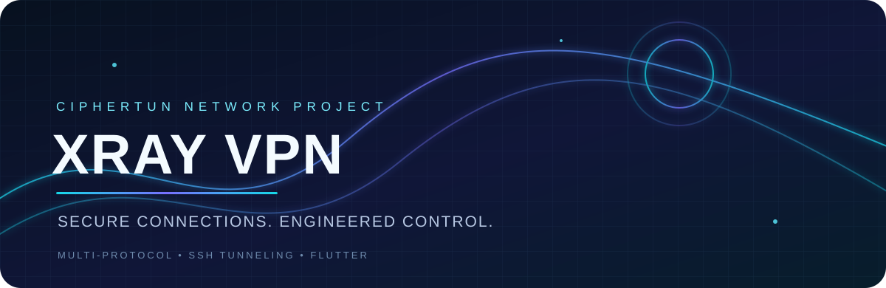
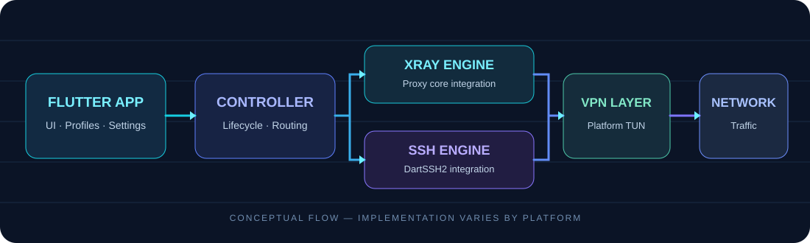

<div align="center">



<br>

<p>
  <a href="https://github.com/CipherTun/Xray-VPN-Workflow/actions"></a>
  <a href="https://github.com/CipherTun/Xray-VPN-Workflow"></a>
  <a href="https://github.com/CipherTun/Xray-VPN-Workflow/issues"></a>
  <a href="https://github.com/CipherTun/Xray-VPN-Workflow/blob/main/LICENSE"></a>
</p>

**A configurable VPN client built around Xray connectivity and SSH tunneling.**

[Overview](#-overview) · [Capabilities](#-capabilities) · [Architecture](#-architecture) · [Build](#-build-from-source) · [Security](#-security--privacy)


</div>

## ◈ Overview

**XRay VPN** is a Flutter-based VPN client project focused on configurable network connections, protocol flexibility and a maintainable cross-platform codebase.

The application brings connection profiles, Xray-powered proxying and SSH tunneling into one interface. Its design separates the Flutter experience from the platform VPN layer and the underlying tunnel engines, making the project easier to inspect, maintain and extend.

> **Project status:** capabilities depend on the platform, bundled core, build configuration and server-side support. Consult the current source and workflow results before treating any feature as production-ready.

## ✦ Capabilities

<table>
<tr>
<td width="50%" valign="top">

### ◈ Connection profiles
- Create and manage connection configurations
- Import supported configuration formats
- Share configurations using the app's protected export flow
- Configure connection-specific options

</td>
<td width="50%" valign="top">

### ⌁ Tunnel engines
- Xray-based proxy connectivity
- SSH tunnel support through DartSSH2
- TUN-based traffic routing on supported platforms
- Platform-specific engine integration

</td>
</tr>
<tr>
<td width="50%" valign="top">

### ⌘ Network configuration
- Custom transport and routing parameters
- DNS and connection settings
- Per-profile configuration
- Connection state and diagnostic information

</td>
<td width="50%" valign="top">

### ◉ User experience
- Flutter interface
- Theme and appearance options
- Permission-aware connection flow
- Local configuration management

</td>
</tr>
</table>

### Protocols and transports

The Xray core supports multiple proxy protocols and transport options. Actual availability is determined by the bundled core version, application integration and remote server configuration.

| Area | Configuration examples |
|---|---|
| Proxy protocols | VLESS, VMess, Trojan, Shadowsocks |
| Transports | TCP, WebSocket, gRPC, HTTP-based transports |
| Security layers | TLS and supported Reality configurations |
| Tunnel mode | Android VPN/TUN integration where configured |
| SSH | SSH-based forwarding and supported payload/transport options |

*This is a capability overview, not a guarantee that every protocol/transport combination is available on every platform or build.*


## ⛓ Architecture



| Layer | Responsibility |
|---|---|
| Flutter application | Screens, profile management, settings and user interaction |
| Connection/controller layer | Coordinates connection lifecycle and configuration |
| Tunnel integrations | Xray and SSH connectivity |
| Platform VPN layer | OS-level VPN permission and traffic routing |
| Core/runtime | Platform-specific native tunnel components |

The exact integration differs between Android and iOS. Refer to the platform source and build scripts for the implementation currently present in this branch.

## 🧰 Technology

<div align="center">


</div>

## 🚀 Build from source

### Requirements

- Flutter SDK compatible with the version declared by the project
- Dart SDK supplied by the selected Flutter installation
- Android SDK and Android build tools required by the Gradle configuration
- Java version required by the Gradle/Android Gradle Plugin configuration
- Git

For iOS builds, use macOS with the required Xcode toolchain and follow the repository's iOS-specific setup instructions.

### Clone

```bash
git clone https://github.com/CipherTun/Xray-VPN-Workflow.git
cd Xray-VPN-Workflow
```

### Install Flutter dependencies

```bash
flutter pub get
```

### Run static analysis

```bash
flutter analyze
```

### Build Android

```bash
flutter build apk --debug
```

The repository's GitHub Actions workflows may perform additional native-core preparation or platform-specific build steps. For a reproducible result, use the workflow defined in the branch you are building rather than assuming a generic local Flutter command includes every preparation step.

### Automated builds

Open the repository's **Actions** tab to inspect available workflows, build logs and generated artifacts:

[**View GitHub Actions →**](https://github.com/CipherTun/Xray-VPN-Workflow/actions)


## 🔐 Security & privacy

VPN software handles sensitive network traffic. Treat configuration files, credentials, private keys and exported profiles accordingly.

- Do not commit server credentials, private keys, signing keys or production secrets.
- Keep signing material and API credentials in protected local files or repository secrets.
- Review imported profiles before connecting.
- Share configuration data only with people and services you trust.
- Use current, trusted core releases and review upstream security advisories.
- A VPN connection does not make a device anonymous or protect against every form of tracking, malware or account compromise.

**Configuration protection is not a substitute for secure device storage, safe credential handling or a security review.**

## 🧭 Platform notes

- **Android:** uses the Android VPN permission and platform-specific tunnel integration. Supported ABIs and native libraries depend on the workflow and packaged artifacts.
- **iOS:** requires the platform-specific Xray/Network Extension integration and the manual setup documented in the repository. Do not assume Android feature parity.
- **SSH:** the SSH tunnel lifecycle depends on the Flutter/runtime lifecycle and the implementation in the current source.

## 🛠 Troubleshooting

1. Confirm the profile is valid and matches the server configuration.
2. Check that the required Android VPN permission has been granted.
3. Inspect the application diagnostics and the relevant GitHub Actions logs.
4. Verify that the selected protocol, transport and security options are supported by the bundled core.
5. Rebuild after changing native dependencies or core preparation scripts.

When reporting a problem, include the platform, app version or commit, selected connection type and relevant sanitized logs. **Remove addresses, UUIDs, passwords, tokens, private keys and other identifying values first.**

## 🤝 Contributing

Contributions that improve reliability, maintainability, documentation, accessibility and platform compatibility are welcome.

1. Fork the repository.
2. Create a focused feature or fix branch.
3. Keep changes scoped and explain any native-core or workflow modifications.
4. Run the checks relevant to the files you changed.
5. Open a pull request with a clear summary and test evidence.

Please avoid submitting credentials, personal configuration files or unreviewed binary artifacts.

## ⚖️ Disclaimer

This project is provided for lawful network connectivity, development and educational purposes. Users are responsible for complying with applicable laws, network policies and service terms. The project does not endorse unauthorized access, service abuse or bypassing restrictions in violation of applicable rules.

## 📡 Project

<div align="center">

<a href="https://github.com/CipherTun/Xray-VPN-Workflow"></a>
<a href="https://github.com/CipherTun/Xray-VPN-Workflow/issues"></a>


<sub>Designed and maintained by <a href="https://github.com/CipherTun">CipherTun</a></sub>

</div>
